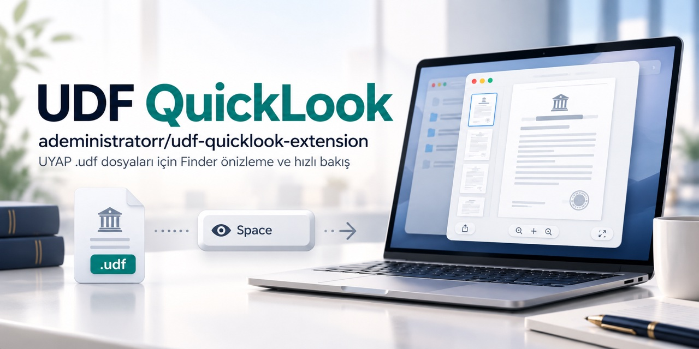
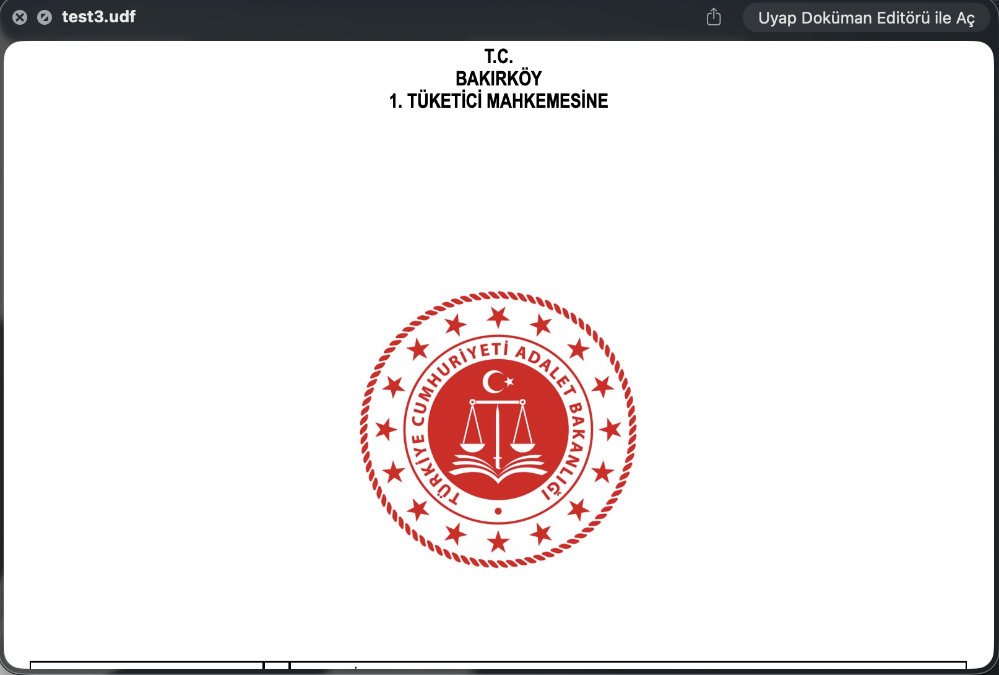
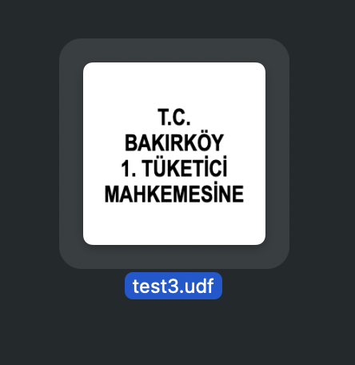

# UDF görüntüleyici (QuickLook) — macOS Apple Silicon

> **Kısa yanıt:** UYAP'tan indirdiğiniz `.udf` dosyalarını açmadan, Finder'da **boşluk tuşuyla** önizlemek ve dosya simgesinde **küçük resim** görmek istiyorsanız bu araç tam bunu yapar: **MacBook, MacBook Pro, MacBook Air, Mac mini ve iMac**'de (Apple Silicon / M serisi / ARM tabanlı işlemci) native Swift ile çalışır; Rosetta veya Java gerekmez. **Salt-okunur görüntüleyicidir** — `.udf` düzenleme, imzalama veya e-imza doğrulama yapmaz; bunun için UYAP Doküman Editörü gerekir. Gayriresmî topluluk çalışmasıdır.

## Hangi araç?

| İhtiyaç | Araç |
|---|---|
| Yalnızca görüntüleme / hızlı önizleme | **Bu proje** (QuickLook + salt-okunur görüntüleyici) |
| Düzenleme / imzalama | [UYAP Doküman Editörü (arm64)](https://github.com/adeministratorr/ude-mac-arm64-1) + arm64 AKİS sürücüsü |
| Resmî editör | [uyap.gov.tr/Uyap-Editor](https://www.uyap.gov.tr/Uyap-Editor) (5.4.21+ Apple Silicon paketi) |

## İlk kez kuranlar için

1. **Kurulum:** [Releases](../../releases) → `UdfQuicklook-arm64-*.dmg` (en hızlı) veya `brew install --cask adeministratorr/tap/udf-quicklook`.
2. **Etkinleştirme:** Sistem Ayarları → Genel → Giriş Öğeleri ve Uzantılar → **Hızlı Bakış** → **UDFViewer** işaretli olmalı.
3. **Başarılı kurulum nasıl anlaşılır?** Finder'da bir `.udf` dosyası seçip **Boşluk** tuşuna basın: önizleme açılır; dosya simgesinde küçük resim görünür.
4. **Sık hata:** Önizleme çıkmıyorsa uzantı işaretli değildir (2. adım) veya QuickLook servisi yeniden başlatılmalıdır: `qlmanage -r`.
5. **Önemli sınır:** Çift tıklama davranışını **değiştirmez** — çift tıklama yine resmî/ kurulu UYAP editörünü açar. İçerik salt-okunur görüntülenir; belgedeki e-imza bu araçta **doğrulanmaz**. Intel Mac desteklenmez.

> **Güvenlik notu:** Bu paket resmî kurum uygulaması değildir. DMG sürümü Developer ID ile imzalı ve Apple notarizasyonundan geçmiştir; sürüm notlarında `sha256` bulunur. Kaynaktan derleme (`kur.sh` / `swift build`) ad-hoc imzalar; betiği çalıştırmadan önce inceleyin.

## Kimler için?

UYAP'tan `.udf` (dilekçe, tebligat, karar, bilirkişi raporu) indiren **avukatlar, bilirkişiler ve arabulucular**; arşiv tarayan **hukuk büroları**; UYAP evrakı işleyen **idari birimler ve kamu çalışanları**; `.udf` dosyalarını UYAP Editör'ü açmadan hızlıca gözden geçirmek isteyen tüm Mac kullanıcıları.

## "UDF dosyası açılmıyor" arayanlar için kısa cevaplar

- **Çift tıklama davranışı değişir mi?** Hayır — çift tıklama eskisi gibi resmî UYAP Editörü'nü açar. Bu araç yalnızca **hızlı bakış önizlemesi + küçük resim** ekler.
- **MacBook / MacBook Pro / MacBook Air / iMac / Mac mini'de çalışır mı?** Evet — Apple Silicon (M1/M2/M3/M4 ve sonrası) modeller. Intel Mac desteklenmez.
- **Salt-okunur görüntüleyici nasıl açılır?** Uygulamayı açıp **Dosya → Aç… (⌘O)** ile `.udf` seçin veya dosyayı uygulama ikonuna sürükleyin.
- **Pencere boş mu açılıyor?** Güncel sürümde boş başlatmada "dosyayı sürükleyin / Aç…" diyen bir karşılama penceresi vardır (bu fork'te eklendi).
- **Önizleme görünmüyor mu?** Sistem Ayarları → Genel → Giriş Öğeleri ve Uzantılar → **Hızlı Bakış** → **UDFViewer** işaretli olmalı.
- **UDF belgeleri e-imzalı; görüntülemek için e-imza gerekir mi?** Hayır — görüntüleme ve önizleme e-imza/kart gerektirmez. Belgeyi düzenleyip imzalamak için [UYAP Doküman Editörü (arm64)](https://github.com/adeministratorr/ude-mac-arm64-1) ve arm64 AKİS sürücüsü gerekir.
- **UYAP Editör gerekir mi?** Önizleme için hayır. "UYAP Editöründe Aç" düğmesi, Uyap Doküman Editörü kuruluysa çalışır.
- **macOS 28 / Rosetta uyarısı mı alıyorsunuz?** Uyarı bu araçtan değil, eski **Intel** AKİS paketinden (`/Applications/Akia.app`) gelir. TÜBİTAK'ın **Arm (Apple Silicon)** paketini kurup eski Intel `Akia.app`'i kaldırın; imzalama için kritik olan `libakisp11.dylib`'in `arm64` içermesidir (ayrıntı: [UYAP Doküman Editörü (arm64)](https://github.com/adeministratorr/ude-mac-arm64-1) README).

## Kurulum (3 yol)

1. **Hazır DMG (en hızlı):** [Releases](../../releases) → `UdfQuicklook-arm64-*.dmg`.
2. **Homebrew cask:**
```bash
brew install --cask adeministratorr/tap/udf-quicklook
```
3. **Tek satır (kaynaktan derler; betiği önce inceleyin):**
```
bash -c "$(curl -fsSL https://raw.githubusercontent.com/adeministratorr/udf-quicklook-extension/main/kur.sh)"
```

> Bu fork'teki sürüm, orijinal projeye ek olarak **UYAP Editör ailesi stiliyle çizilmiş uygulama ikonu** ve **karşılama penceresi** (sürükle-bırak + ⌘O) içerir; çift tıklamayla açıldığında sessizce boş açılmaz.

Diğer araçlar (aynı tap): [e-Devlet E-İmza](https://github.com/adeministratorr/edevlet-eimza-mac-arm64) · [PTT KEP Webmail](https://github.com/adeministratorr/pttkep-eimza-mac-arm64) · [PTT UETS / e-Tebligat](https://github.com/adeministratorr/uets-eimza-mac-arm64) · [TNB Teknoloji İmza](https://github.com/adeministratorr/tnb-eimza-mac-arm64) · [UHAP İmzalama](https://github.com/adeministratorr/uhap-eimza-mac-arm64) · [UYAP Doküman Editörü](https://github.com/adeministratorr/ude-mac-arm64-1)

## Neden bozuktu? Ne düzelttik?

- **Sorun 1 — "uygulama açılmıyor":** Çift tıklanarak başlatıldığında hiçbir pencere görünmüyordu.
- **Neden:** Orijinal kod pencereyi yalnızca bir `.udf` dosyası uygulamaya açıldığında (`application(_:open:)`) oluşturuyordu; dosyasız açılışta ekranda hiçbir şey çıkmıyordu.
- **Çözüm:** Karşılama penceresi eklendi: dosya sürükle-bırak alanı, **Aç… (⌘O)** düğmesi ve Dock'tan yeniden açılınca pencerenin geri gelmesi.
- **Sorun 2 — uygulama ikonu:** Uygulamanın özgün ikonu yoktu (genel ikon).
- **Çözüm:** UYAP Editör ailesi stiline uygun özgün ikon üretildi (`scripts/make-icon.swift`) ve `.app`'e gömüldü.

---

## Neler yapar?

- Finder'da bir `.udf` dosyasına **boşluk (space)** tuşuna basınca **önizleme**.
- Finder'da dosya simgesinde **küçük resim (thumbnail)**.
- **Salt-okunur görüntüleyici** (metin seçilip kopyalanabilir) ve içinde **"UYAP Editöründe Aç"** düğmesi (Uyap Doküman Editörü kuruluysa).

> Not: Bu araç `.udf` dosyalarının **çift tıklama (varsayılan uygulama)** ilişkisini **değiştirmez**. Çift tıklama eskisi gibi resmî UYAP editörünü açmaya devam eder; bu uygulama yalnızca QuickLook önizleme + thumbnail ekler.

## Ekran görüntüleri

| Hızlı Bakış önizleme (SPACE) | Finder küçük resmi |
|:---:|:---:|
|  |  |

## Önizleme görünmüyorsa

Sistem Ayarları → Genel → Giriş Öğeleri ve Uzantılar → **Hızlı Bakış** → **UDFViewer** işaretli olmalı.

## Geliştirici notları

Saf SwiftPM ile derlenir (tam Xcode gerekmez):

- `swift build -c release` + `scripts/build.sh` → `.app` ve iki `.appex` paketini elle monte edip ad-hoc imzalar (eklentiler `_NSExtensionMain` giriş noktasıyla kurulur).
- `kur.sh` bunu sarmalar: Command Line Tools'u kurar, derler, `/Applications`'a koyar, QuickLook eklentilerini kaydeder/etkinleştirir.
- İkon `scripts/make-icon.swift` ile üretilir (`assets/UDFViewer.icns`); `build.sh` ikon dosyası yoksa yeniden üretir.

## Kredi

Orijinal proje: [saidsurucu/udf-quicklook-extension](https://github.com/saidsurucu/udf-quicklook-extension). Bu fork; Apple Silicon dağıtım paketi (DMG + Homebrew cask), uygulama ikonu ve karşılama penceresi düzeltmelerini ekler.
